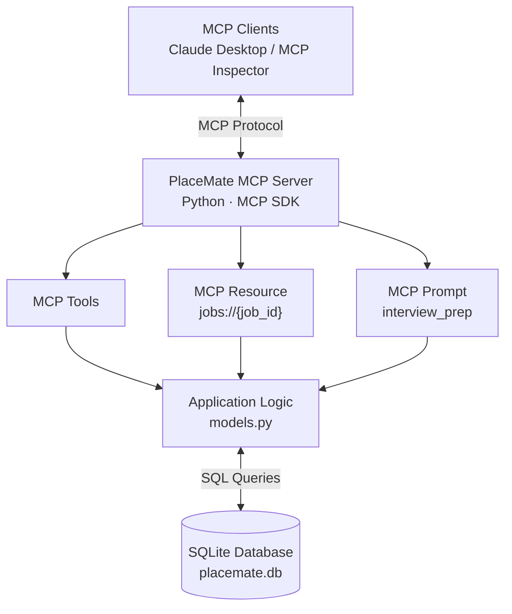

# PlaceMate – MCP-Powered Campus Placement Assistant

PlaceMate is a Python-based campus placement assistant built using the **Model Context Protocol (MCP)**. It connects AI clients such as Claude Desktop with structured placement data, enabling users to search job opportunities, manage applications, retrieve job details, and generate interview preparation guidance through natural language interactions.

## Overview

PlaceMate demonstrates how MCP enables AI applications to interact with external data and application functionality through standardized interfaces.

The project implements MCP **Tools, Resources, and Prompts**, backed by a local SQLite database.

## Key Features

### MCP Tools

| Tool | Description |
|---|---|
| `search_jobs` | Search available jobs using keywords and location. |
| `add_application` | Record a student's application for a selected job. |
| `list_applications` | Retrieve a student's application history. |
| `update_status` | Update the status of an existing application. |

### MCP Resource

| Resource | Description |
|---|---|
| `jobs://{job_id}` | Retrieve detailed information about a specific job. |

### MCP Prompt

| Prompt | Description |
|---|---|
| `interview_prep` | Generate structured interview preparation guidance for a specific job role and company. |

## Architecture



### Architecture Overview

- **MCP Clients:** Claude Desktop and MCP Inspector interact with the PlaceMate server.
- **MCP Server:** Built with Python and the MCP SDK. Exposes tools, resources, and prompts.
- **MCP Tools:** Support job searching and placement application management.
- **MCP Resource:** Provides job details through a resource URI.
- **MCP Prompt:** Generates an interview preparation prompt based on a job title and company.
- **Application Logic:** Handles database operations through `models.py`.
- **SQLite Database:** Stores sample job listings and student application records.

## Technology Stack

- **Language:** Python 3.12+
- **Protocol:** Model Context Protocol (MCP)
- **MCP SDK:** Python MCP SDK 2.3.0+
- **Database:** SQLite
- **Dependency Management:** uv
- **AI Client:** Claude Desktop
- **Testing:** MCP Inspector

## Project Structure

```text
PlaceMate/
│
├── server.py          # MCP server implementation
├── database.py        # Database initialization and connection
├── models.py          # Database operations
├── pyproject.toml     # Project configuration
├── uv.lock            # Dependency lock file
├── .python-version    # Python version configuration
│
└── src/
    └── placemate/
        └── __init__.py
```

## Getting Started

### Prerequisites

- Python 3.12 or later
- [uv](https://docs.astral.sh/uv/getting-started/installation/)
- [Claude Desktop](https://claude.com/download)

### 1. Clone the repository

```bash
git clone https://github.com/16ajoop/mcp-projects.git
cd mcp-projects/PlaceMate
```

### 2. Install dependencies

```bash
uv sync
```

### 3. Run the MCP server

```bash
uv run python server.py
```

The server uses standard input/output (stdio) communication and is intended to be launched by an MCP-compatible client.

## Claude Desktop Integration

Add the following configuration to your Claude Desktop MCP server configuration.

Replace the example project directory with the absolute path to your local PlaceMate folder.

```json
{
  "mcpServers": {
    "PlaceMate": {
      "command": "uv",
      "args": [
        "--directory",
        "C:\\path\\to\\mcp-projects\\PlaceMate",
        "run",
        "python",
        "server.py"
      ]
    }
  }
}
```

Restart Claude Desktop after saving the configuration.

Once connected, you can interact with PlaceMate through natural language requests.

**Example interactions:**

- "Find Python developer jobs in Chennai."
- "Add my application for job ID 1."
- "Show my application history."
- "Update my application status to shortlisted."
- "Retrieve the details of job ID 2."
- "Help me prepare for an interview at TechNova."

## Testing with MCP Inspector

PlaceMate can also be tested independently using MCP Inspector.

Run:

```bash
uv run mcp dev server.py
```

Use the Inspector interface to explore and test the available tools, resource, and prompt.

## Sample Job Data

The application initializes a local SQLite database with sample placement opportunities.

| ID | Position | Company | Location |
|---|---|---|---|
| 1 | Junior Python Developer | TechNova | Chennai |
| 2 | Data Analyst Trainee | InsightWorks | Hyderabad |
| 3 | ML Engineer Intern | VisionAI | Bengaluru |

Application statuses include:

- Applied
- Shortlisted
- Interview
- Offer
- Rejected

## Implementation Highlights

- Developed an MCP server using the Python MCP SDK.
- Implemented callable tools for job search and application management.
- Exposed structured job information through MCP resources.
- Created reusable interview preparation prompts.
- Integrated SQLite for persistent local data storage.
- Connected the MCP server with Claude Desktop.
- Tested MCP capabilities using MCP Inspector.

## Project Scope

PlaceMate is a learning and demonstration project focused on MCP server development and AI-client integration.

- Uses predefined sample job listings.
- Stores application records locally in SQLite.
- Does not retrieve live job vacancies.
- Does not submit applications to external company websites.

---
## Author

**Pooja V**  
AI & Data Science Engineer

- GitHub: [@16ajoop](https://github.com/16ajoop)
- MCP Projects: [mcp-projects](https://github.com/16ajoop/mcp-projects)

---

*Part of the [MCP Projects](https://github.com/16ajoop/mcp-projects) repository.*

**Developed as a hands-on exploration of Model Context Protocol, Python, and AI application integration.**
