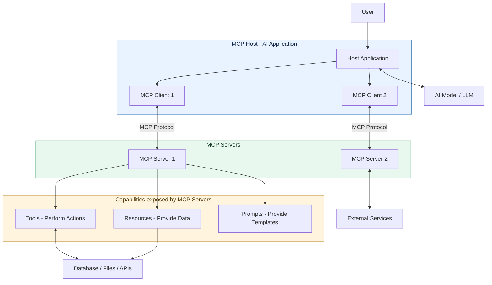
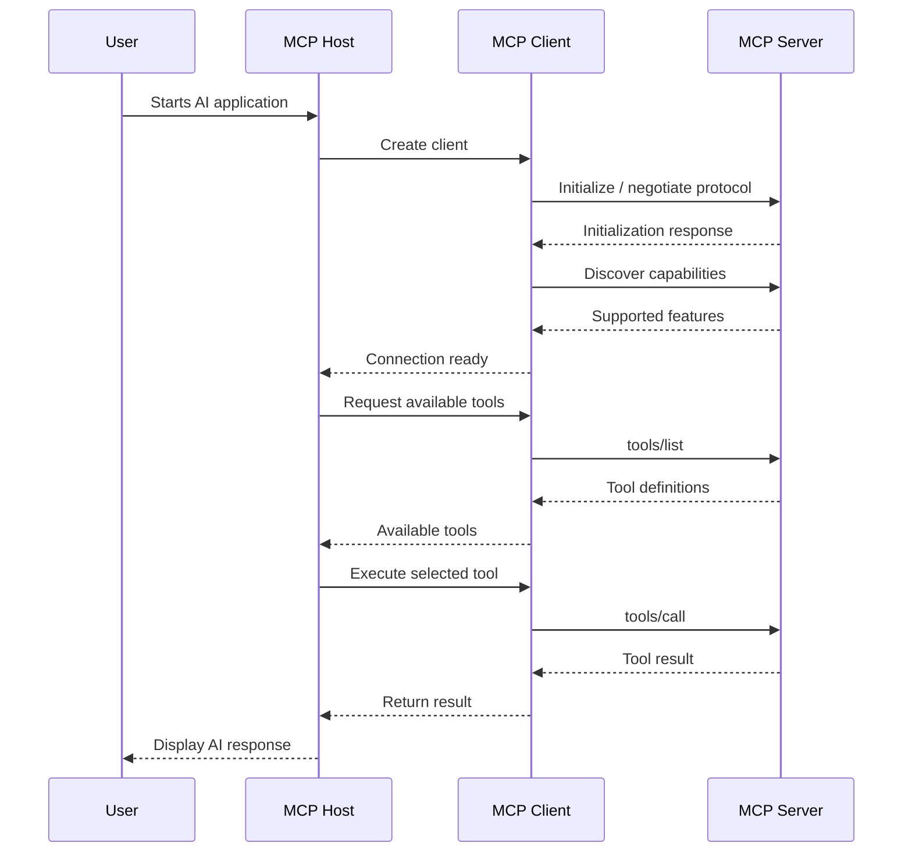
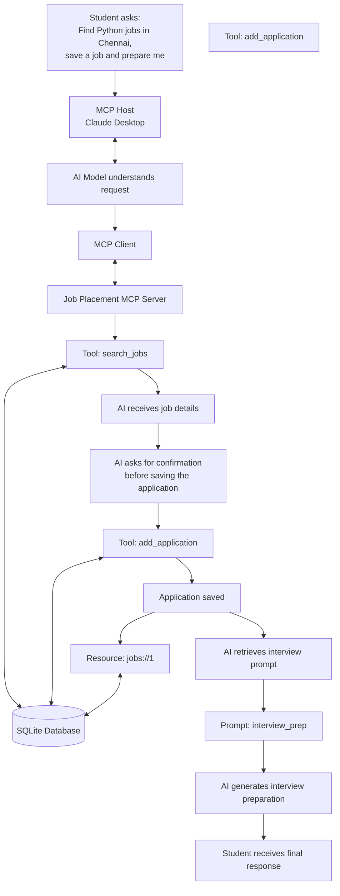

# Model Context Protocol (MCP) – Learning & Projects

**Author:** Pooja V  
**Role:** AI & Data Science Engineer  
**GitHub:** [@16ajoop](https://github.com/16ajoop)

A practical learning and development repository exploring the **Model Context Protocol (MCP)** through Python-based implementations, AI integrations, and real-world applications.

This repository covers MCP fundamentals, architecture, communication, server capabilities, client interactions, security, and practical implementations. Each project is maintained in its own directory to keep the code modular and easy to explore.

---

# 1. What is Model Context Protocol (MCP)?

The **Model Context Protocol (MCP)** is an open standard that enables AI applications to communicate with external tools, data sources, and services through a consistent interface.

Think of MCP as a common communication language between AI applications and external systems.

Without MCP, developers often need to build separate integrations for every AI application and external service. MCP provides a standardized approach that allows compatible AI applications to connect to MCP servers without requiring a completely different integration for every connection.

### A simple example

Imagine asking an AI assistant:

> Find Python developer jobs in Chennai, save a job to my applications, and help me prepare for the interview.

The AI model can understand the request, but it needs access to an external system to search job listings, store applications, and retrieve job information.

An MCP server can expose these capabilities through standardized tools, resources, and prompts.

The AI application can then interact with those capabilities through MCP.

### What MCP helps achieve

- Connect AI applications to external systems.
- Retrieve relevant information from databases and APIs.
- Allow AI applications to execute approved actions.
- Reuse integrations across compatible AI applications.
- Build modular and reusable AI integrations.
- Separate AI orchestration from external system functionality.

**Important:** MCP is a communication protocol, not an AI model, agent framework, database, or automation engine. The AI application still handles model orchestration and decides how to use the capabilities made available through MCP.

---

# 2. MCP Architecture

MCP follows a **Host–Client–Server architecture**.

There are three main participants:

| Component | Responsibility |
|---|---|
| MCP Host | The AI application that manages the interaction and coordinates MCP connections. |
| MCP Client | The protocol component inside the host that communicates with an MCP server. |
| MCP Server | A program that exposes tools, resources, and prompts to the client. |

### Easy-to-understand architecture diagram



### How the components work

**1. MCP Host**

The host is the AI application the user interacts with.

Examples:
- Claude Desktop
- Claude Code
- ChatGPT (MCP-compatible integrations)
- Google Gemini CLI and MCP-compatible Gemini applications
- IDEs with MCP support
- Custom AI applications

Responsibilities:
- Interact with the user.
- Coordinate the AI model.
- Create and manage MCP clients.
- Manage server connections and permissions.
- Present tool results and responses.

**2. MCP Client**

The client is the communication layer between the host and an MCP server.

Responsibilities:
- Connect to MCP servers.
- Discover server capabilities.
- Send protocol requests.
- Receive and process responses.
- Manage communication and connection lifecycle.

A host can manage multiple MCP clients. Each client communicates with a particular MCP server.

**3. MCP Server**

The server is the program that exposes functionality to an AI application.

It can be developed using Python, TypeScript, Java, C#, and other supported languages.

Responsibilities:
- Register tools, resources, and prompts.
- Receive requests from MCP clients.
- Execute the required application logic.
- Communicate with databases, APIs, and other systems.
- Return structured results.

An MCP server can run locally on a user's machine or remotely on a server.

---

# 3. Core MCP Server Concepts

MCP servers expose three important building blocks:

- Tools
- Resources
- Prompts

These are often called the core server primitives.

## 3.1 Tools

**Tools allow AI applications to perform actions.**

They are executable functions exposed by an MCP server. The AI model can decide when a tool is appropriate based on the user's request and the tool's description.

Examples:

- Search for jobs.
- Retrieve weather information.
- Create a calendar event.
- Insert a database record.
- Send a message.
- Update an application status.

### Example

A job placement MCP server might expose:

```python
@mcp.tool()
def search_jobs(keyword: str = "", location: str = ""):
    """Search available job listings."""
    return find_matching_jobs(keyword, location)
```

The tool has:
- A name: `search_jobs`
- A description
- Input parameters
- An implementation
- A result returned to the client

**Important:** The AI model does not directly execute the Python function. The host/client handles the MCP tool request, the server executes the function, and the result is returned to the AI application.

## 3.2 Resources

**Resources provide contextual data to AI applications.**

They expose information that an application can read and use as context.

Examples:

- Database records.
- File contents.
- Documentation.
- API responses.
- Project information.
- Configuration details.

Resources are identified using URIs.

### Example

```python
@mcp.resource("jobs://{job_id}")
def get_job(job_id: int):
    """Retrieve details of a specific job."""
    return get_job_details(job_id)
```

Example resource URI:

```text
jobs://1
```

The client can read the resource to retrieve the relevant job information.

Resources are generally application-controlled: the host decides when and how their contents are included in the AI context.

## 3.3 Prompts

**Prompts are reusable instruction templates exposed by MCP servers.**

They help standardize common AI interactions.

Examples:

- Interview preparation.
- Code review.
- Data analysis.
- Document summarization.
- Report generation.

### Example

```python
@mcp.prompt()
def interview_prep(job_title: str, company: str):
    """Generate an interview preparation prompt."""
    return f"""
    Prepare interview questions for the role of {job_title}
    at {company}.

    Include technical questions, practical scenarios,
    and suggested preparation topics.
    """
```

The host can retrieve the prompt and use it to guide the AI model.

### Tools vs Resources vs Prompts

| Feature | Purpose | Simple question |
|---|---|---|
| Tools | Perform actions | Can you do something? |
| Resources | Provide information | Can you read something? |
| Prompts | Provide reusable instructions | Can you follow a prepared template? |

Example:

- Tool: Search for a Python developer job.
- Resource: Read the details of a particular job.
- Prompt: Prepare interview questions for that job.

---

# 4. MCP Client Features

MCP clients can also expose capabilities that servers use.

## 4.1 Roots

Roots allow a client to communicate which filesystem locations are relevant to an MCP operation.

Example:

A coding assistant might provide the following workspace root:

```text
C:/Users/Developer/Projects/
```

An MCP server can use this information to understand the intended workspace boundaries.

**Note:** Roots are not a filesystem permission system. Servers must still enforce appropriate access controls.

## 4.2 Elicitation

Elicitation allows an MCP server to request additional information from the user through the host application.

Example:

A user asks:

> Book a meeting for tomorrow.

The server may need additional information:

- What time should the meeting start?
- What is the meeting title?
- Who should attend?

The server can request the missing information through an elicitation interaction.

Elicitation can also support confirmation workflows, depending on the supported elicitation mode and client.

## 4.3 Sampling

Sampling is a mechanism through which an MCP server can request an LLM completion from the host application.

Historically, this allowed servers to use the host's model without directly integrating a particular LLM provider.

**Version note:** Sampling is deprecated in the MCP specification dated 2026-07-28. New implementations should generally integrate directly with an LLM provider when model generation is required. Older protocol versions and SDKs may still expose sampling.

---

# 5. How MCP Communication Works

MCP uses **JSON-RPC 2.0** as its message format.

JSON-RPC defines how requests, responses, and notifications are represented.

### Main message types

**1. Request**

One participant asks another participant to perform an operation.

Example:

```json
{
  "jsonrpc": "2.0",
  "id": 1,
  "method": "tools/list"
}
```

**2. Response**

The receiving participant returns the result of a request.

Example:

```json
{
  "jsonrpc": "2.0",
  "id": 1,
  "result": {
    "tools": []
  }
}
```

**3. Notification**

A notification communicates an event without requiring a response.

Examples:
- Progress updates.
- Resource changes.
- Tool list changes.
- Other supported protocol events.

### Common MCP operations

| Operation | Purpose |
|---|---|
| `tools/list` | Discover available tools |
| `tools/call` | Execute a tool |
| `resources/list` | Discover available resources |
| `resources/read` | Read a resource |
| `resources/templates/list` | Discover resource templates |
| `prompts/list` | Discover available prompts |
| `prompts/get` | Retrieve a prompt |

The exact methods available depend on the negotiated protocol version and supported capabilities.

---

# 6. MCP Transport Mechanisms

A transport determines how MCP messages move between a client and a server.

MCP defines two main standard transports.

## 6.1 STDIO

STDIO stands for Standard Input / Standard Output.

It is commonly used when the MCP server runs as a local process.

Communication happens through:
- Standard input (`stdin`)
- Standard output (`stdout`)

Example:

```text
Claude Desktop
      |
      | Starts local process
      v
Python MCP Server
      |
      | Database operations
      v
SQLite Database
```

Example configuration:

```json
{
  "mcpServers": {
    "placemate": {
      "command": "uv",
      "args": [
        "--directory",
        "C:\\path\\to\\PlaceMate",
        "run",
        "python",
        "server.py"
      ]
    }
  }
}
```

Important:
- Do not print debugging messages to standard output.
- Use standard error (`stderr`) for diagnostic logs.
- The host generally launches and manages the local server process.

**Common use cases:** Local files, databases, development tools, and desktop integrations.

## 6.2 Streamable HTTP

Streamable HTTP is used when an MCP server is accessed over a network.

It supports HTTP-based communication and optional Server-Sent Events (SSE) for streaming.

Example:

```text
AI Application
      |
      | HTTP Requests
      v
Remote MCP Server
      |
      v
External APIs / Database
```

Common use cases:
- Remote MCP services.
- Cloud-hosted integrations.
- Shared enterprise services.
- Applications connecting to remote databases or APIs.

### STDIO vs Streamable HTTP

| Feature | STDIO | Streamable HTTP |
|---|---|---|
| Communication | Standard input/output | HTTP |
| Typical deployment | Local process | Remote or network service |
| Server startup | Usually managed by host | Usually independently deployed |
| Authentication | Local process and OS security | HTTP authentication mechanisms |
| Typical use | Desktop integrations | Remote integrations |

Older implementations may use the HTTP+SSE transport. For new implementations, prefer Streamable HTTP.

---

# 7. MCP Lifecycle

The lifecycle describes how an MCP client and server establish communication and exchange messages.

A simplified lifecycle:



### Lifecycle stages

1. **Initialization:** The client and server establish protocol compatibility and exchange supported capabilities.
2. **Capability discovery:** The client learns which features the server supports.
3. **Operation:** The client and server exchange requests, responses, and notifications.
4. **Shutdown:** The communication is terminated or the server process is closed.

The precise initialization and discovery methods depend on the MCP protocol version. Older protocol versions use the familiar `initialize` and `notifications/initialized` exchange; newer specification revisions have evolved parts of discovery and request metadata.

---

# 8. Advanced MCP Concepts

Beyond the three core server primitives, MCP provides additional capabilities and protocol utilities.

## 8.1 Resource Templates

Resource templates allow servers to expose parameterized resource URIs.

Example:

```text
jobs://{job_id}
```

A client can use the template to identify resources for different job IDs.

## 8.2 Resource Subscriptions

Clients can subscribe to supported resources to receive notifications when their contents change.

Example:

A client subscribes to a job listing resource. When the server detects a supported resource update, it can notify the client.

Subscriptions require the relevant server and client capabilities.

## 8.3 Progress Notifications

Progress notifications communicate updates during long-running operations.

Example:

```text
Reading documents: 25%
Reading documents: 50%
Reading documents: 75%
Processing complete.
```

## 8.4 Cancellation

Cancellation allows a client to request that an ongoing operation be stopped.

Example:

A user cancels a lengthy document-processing operation.

The server should handle cancellation safely and clean up any work that can be stopped.

## 8.5 Pagination

Pagination allows large lists of resources, tools, or prompts to be returned in smaller portions.

Example:

Instead of returning 10,000 records at once, a server can return a page and a cursor for retrieving the next page.

## 8.6 Completions

Completion support helps clients obtain suggestions for partially entered prompt arguments or resource-template values.

Example:

When a user enters a company name, the server may provide matching suggestions.

## 8.7 Logging

Logging supports diagnostics and monitoring of server operations.

For local STDIO servers, diagnostic output should generally be written to `stderr`, not `stdout`, because stdout carries protocol messages.

New implementations should follow the logging guidance for their chosen protocol version.

## 8.8 Tasks

Tasks are an optional protocol extension for operations that may take a long time.

Instead of waiting for an entire operation to finish in one request, a client can work with a task handle and retrieve its status or result later.

Example:

A server begins processing a large set of documents. The client can check the task's progress and retrieve the completed result.

Task support depends on the protocol revision and implementation.

---

# 9. MCP Security

Security is an important part of MCP development because servers may access sensitive files, databases, APIs, and business operations.

### Important security practices

**1. User consent**

Users should understand and approve sensitive actions.

Example: Confirm before sending an email or deleting a file.

**2. Least privilege**

Give the server only the permissions it needs.

Example: A job-search server should not need unrestricted access to the entire filesystem.

**3. Input validation**

Validate all tool arguments before executing operations.

**4. Authentication**

Verify the identity of users or systems accessing protected services.

**5. Authorization**

Check whether an authenticated user is allowed to perform a particular action.

**6. Secret management**

Never hardcode API keys, passwords, or access tokens in source code or commit them to GitHub.

Use environment variables or an appropriate secret-management system.

**7. Output validation**

Treat external content as untrusted. Validate and safely handle information returned by APIs, databases, and other tools.

**8. Tool execution controls**

High-impact actions should have appropriate user confirmation and authorization checks.

**9. Server isolation**

Do not assume that one MCP server can safely access another server's context or the host's entire conversation.

### Authentication and authorization

For remote HTTP servers, MCP supports HTTP-based authorization mechanisms, including OAuth-based flows where applicable.

STDIO servers commonly rely on local operating-system permissions and the host's process configuration.

MCP does not automatically make a server secure. Security must be implemented in the application and deployment.

---

# 10. Building an MCP Server

An MCP server can be developed using an MCP SDK.

Popular SDK ecosystems include:

- Python
- TypeScript
- Java
- C#
- Go
- Kotlin
- Swift
- Rust

### Typical development workflow

```text
Understand the use case
        |
        v
Identify external systems
        |
        v
Choose an MCP SDK
        |
        v
Implement server
        |
        v
Add tools, resources and prompts
        |
        v
Connect database / API / service
        |
        v
Test using MCP Inspector
        |
        v
Connect to an MCP Host
        |
        v
Apply security and deployment controls
```

### Useful development tools

| Tool | Purpose |
|---|---|
| MCP SDK | Build MCP clients and servers |
| MCP Inspector | Inspect and test MCP servers |
| Claude Desktop | Connect to and test local MCP servers |
| Python | Implement server logic |
| SQLite / PostgreSQL | Store application data |
| Git / GitHub | Version control and project management |
| Docker | Package and run services |

### Example Python server structure

```text
my-mcp-server/
│
├── server.py
├── database.py
├── models.py
├── pyproject.toml
├── uv.lock
│
└── src/
    └── my_mcp_server/
        └── __init__.py
```

A typical server implementation contains:
- Server initialization.
- Tool registration.
- Resource registration.
- Prompt registration.
- Database or API integration.
- Error handling.
- Transport configuration.

---

# 11. Real-World Example: AI-Powered Job Placement Assistant

Let's understand how MCP works through a practical example.

### Scenario

A student asks an AI assistant:

> Find Python developer jobs in Chennai, save the best matching job to my applications, and prepare me for its interview.

Assume the AI application is connected to a Job Placement MCP server.

### Components involved

| Component | Example |
|---|---|
| MCP Host | Claude Desktop |
| AI Model | LLM available to the host |
| MCP Client | Client managed by Claude Desktop |
| MCP Server | Job Placement MCP Server |
| Tools | `search_jobs`, `add_application`, `list_applications`, `update_status` |
| Resource | `jobs://1` |
| Prompt | `interview_prep` |
| Database | SQLite |

### Real-world workflow diagram



### Step-by-step MCP flow

**Step 1 – User submits a request**

The student asks:

> Find Python developer jobs in Chennai.

The host sends the request to the AI model.

**Step 2 – AI identifies the required capability**

The AI recognizes that it needs job-search functionality.

It selects the available `search_jobs` tool.

**Step 3 – Client sends an MCP request**

The MCP client sends a `tools/call` request to the Job Placement MCP server.

Example arguments:

```json
{
  "keyword": "Python Developer",
  "location": "Chennai"
}
```

**Step 4 – Server executes the tool**

The server receives the request and executes the Python function.

The function queries the SQLite database.

**Step 5 – Server returns the results**

The server returns matching job information through the MCP protocol.

Example:

```text
Job ID: 1
Role: Junior Python Developer
Company: TechNova
Location: Chennai
Skills: Python, SQL
```

The host provides the result to the AI model.

**Step 6 – AI asks to save the application**

The AI identifies a suitable job and asks:

> Would you like me to save this job to your applications?

The user confirms.

**Step 7 – Application is saved**

The AI selects `add_application`.

The MCP client sends the tool request to the server.

The server inserts the application record into SQLite.

**Step 8 – Job details are retrieved**

The client reads the relevant resource:

```text
jobs://1
```

The server returns the job details.

**Step 9 – Interview preparation**

The host retrieves the `interview_prep` prompt with the job title and company as arguments.

The AI model uses the prompt to generate relevant interview preparation material.

**Step 10 – Final response**

The student receives:

- Matching job details.
- Confirmation that the application was saved.
- Technical interview questions.
- Suggested preparation topics.

### What does this example demonstrate?

| MCP concept | How it is used |
|---|---|
| Host | Claude Desktop |
| Client | Manages communication with the server |
| Server | Provides placement functionality |
| Tool | Searches and saves applications |
| Resource | Provides job details |
| Prompt | Structures interview preparation |
| JSON-RPC | Carries protocol messages |
| Transport | Carries messages between client and server |
| Database | Stores jobs and applications |

This is an example of how an AI application can interact with an external system using MCP instead of requiring every AI application to implement a separate custom integration.

---

# 12. PlaceMate – Practical MCP Implementation

**PlaceMate** is the first practical implementation in this repository.

It is a Python-based MCP-powered campus placement assistant that demonstrates how MCP tools, resources, and prompts can be connected to application logic and a SQLite database.

### Implemented capabilities

| MCP feature | Implementation |
|---|---|
| Tool | `search_jobs` |
| Tool | `add_application` |
| Tool | `list_applications` |
| Tool | `update_status` |
| Resource | `jobs://{job_id}` |
| Prompt | `interview_prep(job_title, company)` |

### Technology stack

- Python
- MCP Python SDK
- SQLite
- uv
- Claude Desktop
- MCP Inspector

### Project structure

```text
mcp-projects/
│
├── README.md
├── .gitignore
│
├── PlaceMate/
│   ├── server.py
│   ├── database.py
│   ├── models.py
│   ├── pyproject.toml
│   ├── uv.lock
│   ├── .python-version
│   └── src/
│       └── placemate/
│           └── __init__.py
│
└── Future-MCP-Projects/
```

### Run PlaceMate locally

```bash
git clone https://github.com/16ajoop/mcp-projects.git
cd mcp-projects/PlaceMate
uv sync
uv run python server.py
```

To test using MCP Inspector:

```bash
uv run mcp dev server.py
```

**Project scope:** PlaceMate currently uses locally stored sample job listings and SQLite application records. It does not fetch live job listings or submit applications to external recruitment websites.

Explore the implementation:

[PlaceMate – MCP Campus Placement Assistant](./PlaceMate/README.md)

---

# 13. MCP Projects

This repository is organized so that additional MCP implementations can be added independently.

| Project | Description | Status |
|---|---|---|
| [PlaceMate](./PlaceMate/) | MCP-powered campus placement assistant using Python and SQLite | Implemented |

More MCP projects and experiments will be added as development progresses.

---

# 14. Key Takeaways

- MCP is an open standard for connecting AI applications with external capabilities and context.
- The three main participants are Host, Client, and Server.
- Tools allow AI applications to perform actions.
- Resources provide contextual data.
- Prompts provide reusable instruction templates.
- MCP uses JSON-RPC 2.0 for protocol messages.
- STDIO and Streamable HTTP are the standard transport mechanisms.
- Capability discovery helps clients understand server functionality.
- Roots and Elicitation are important client-side capabilities.
- Security, permissions, and user consent are essential when building MCP servers.
- MCP integrations are modular and can be reused across compatible AI applications.

---

# 15. Official Learning Resources

Use the official documentation as the primary reference when implementing MCP features.

- [MCP Official Documentation](https://modelcontextprotocol.io/)
- [MCP Architecture](https://modelcontextprotocol.io/docs/learn/architecture)
- [MCP Server Concepts](https://modelcontextprotocol.io/docs/learn/server-concepts)
- [MCP Client Concepts](https://modelcontextprotocol.io/docs/learn/client-concepts)
- [MCP Specification](https://modelcontextprotocol.io/specification/)
- [MCP Python SDK](https://github.com/modelcontextprotocol/python-sdk)
- [MCP TypeScript SDK](https://github.com/modelcontextprotocol/typescript-sdk)
- [MCP Inspector](https://github.com/modelcontextprotocol/inspector)

---

## Author

**Pooja V**  
AI & Data Science Engineer

- GitHub: [@16ajoop](https://github.com/16ajoop)
- Main MCP Repository: [mcp-projects](https://github.com/16ajoop/mcp-projects)

*Learning, building, and exploring practical applications of Model Context Protocol.*
